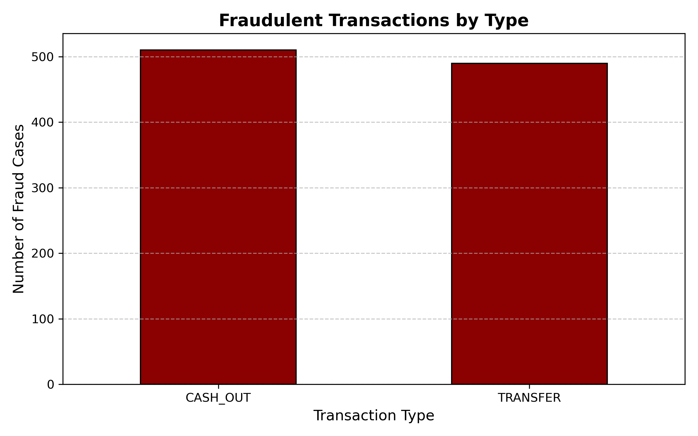
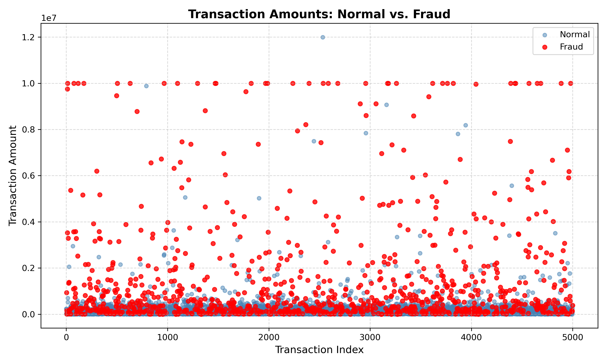

# AML Fraud Detection & Policy-Grounded Alert Agent

An end-to-end machine learning and Retrieval-Augmented Generation (RAG) system for Anti-Money Laundering (AML) transaction screening. This project combines a leak-free `scikit-learn` fraud classification pipeline with a local `FAISS` vector store and `Groq` LLM inference to flag high-risk financial transactions and generate structured, policy-grounded compliance alerts.

---

## System Architecture

1. **Data Sampling & EDA (`1_data_cleaning.ipynb`):** Processes the PaySim synthetic financial dataset, constructs a stratified 5,000-transaction sample (1,000 fraud / 4,000 normal), and generates exploratory visualizations of fraud typology and transaction amount distributions.
2. **Leak-Free ML Pipeline (`2_model_training.ipynb`):** Trains a `LogisticRegression` pipeline (`StandardScaler` + `OneHotEncoder`) using a 70/15/15 stratified train/validation/test split. Probability thresholds are tuned strictly on the validation split to maximize F1-score before final evaluation on the held-out test set.
3. **Semantic Policy Indexing (`aml_compliance_policy.txt` & `test_rag.py`):** Splits corporate AML compliance rules at the rule level, embeds them locally using `sentence-transformers/all-MiniLM-L6-v2`, and indexes them in a local `FAISS` vector store.
4. **LLM Compliance Agent (`3_rag_agent.py` & `run_demo.py`):** Evaluates incoming transactions by combining the ML risk probability score with the top-$k$ ($k=2$) retrieved AML policy rules, prompting `openai/gpt-oss-20b` via the Groq API to output a deterministic JSON compliance alert.

---

## Tech Stack

* **Machine Learning & Data Analysis:** Python, pandas, NumPy, scikit-learn, joblib, Matplotlib
* **RAG & LLM Orchestration:** LangChain, FAISS (`faiss-cpu`), Hugging Face Sentence Transformers (`all-MiniLM-L6-v2`), Groq API (`ChatGroq`)
* **Environment & Configuration:** `python-dotenv`, Jupyter Notebook

---

## Exploratory Data Analysis & Feature Engineering

### Data Leakage Prevention
In the PaySim dataset, fraudulent transactions are canceled upon detection, meaning account balance columns (`oldbalanceOrg`, `newbalanceOrig`, `oldbalanceDest`, `newbalanceDest`) directly leak target labels if passed into a supervised classifier. 

To maintain strict separation of concerns:
* **ML Classifier Inputs:** Restricted strictly to non-leaking pre-transaction features (`step`, `type`, `amount`).
* **RAG Policy Engine Inputs:** Utilizes full transaction context—including account balance deltas and merchant prefixes (`M`)—for post-scoring compliance rule verification. Because PaySim does not track balances for merchant accounts (IDs starting with `M`), the interactive pipeline automatically handles `0.0` balance placeholders.

### Visual Insights





---

## Model & RAG Evaluation

### 1. Machine Learning Classifier Performance
Evaluated on the untouched 15% held-out test set ($N = 750$) using the probability decision threshold ($\tau = 0.3570$) optimized on the validation split:

| Metric | Score |
| :--- | :--- |
| **Validation PR-AUC** | `0.7040` |
| **Validation F1-Score (at $\tau = 0.3570$)** | `0.7192` |
| **Test PR-AUC** | **`0.7390`** |
| **Test Accuracy** | `87.47%` |

#### Held-Out Test Set Classification Report
| Class | Precision | Recall | F1-Score | Support |
| :--- | :---: | :---: | :---: | :---: |
| **Normal (`0`)** | 0.92 | 0.92 | 0.92 | 600 |
| **Fraud (`1`)** | 0.68 | 0.69 | 0.69 | 150 |
| **Macro Avg** | 0.80 | 0.81 | 0.81 | 750 |
| **Weighted Avg** | 0.88 | 0.87 | 0.87 | 750 |

#### Confusion Matrix ($\tau = 0.357$)
* **True Negatives (TN):** 552 | **False Positives (FP):** 48
* **False Negatives (FN):** 46 | **True Positives (TP):** 104

### 2. RAG Policy Retrieval Benchmark
`test_rag.py` evaluates semantic retrieval across a 12-case compliance benchmark covering single-rule and multi-rule violations:
* **Rule 101 — High-Value Evasion:** `TRANSFER` or `CASH_OUT` exceeding $200,000$.
* **Rule 102 — Account Takeover & Depletion:** Transactions draining `oldbalanceOrg` completely to a `newbalanceOrig` of $0.0$.
* **Rule 103 — Mule Account Indication:** `TRANSFER` exceeding $50,000$ to a recipient account with `oldbalanceDest = 0.0`.
* **Rule 104 — Abnormal Merchant Payments:** `PAYMENT` exceeding $100,000$ to a merchant account (ID starting with `M`).

---

## Repository Structure

```text
├── 1_data_cleaning.ipynb        # Dataset downsampling & Matplotlib visualizations
├── 2_model_training.ipynb       # Stratified split, Pipeline training, PR-AUC tuning & export
├── 3_rag_agent.py               # Batch RAG alert generator on sampled fraud cases
├── run_demo.py                  # Interactive CLI for real-time transaction scoring & RAG alerts
├── test_rag.py                  # 12-case benchmark evaluating FAISS top-2 retrieval accuracy
├── aml_compliance_policy.txt    # Corporate AML policy knowledge base (Rules 101–104)
├── fraud_by_type.png            # EDA chart: Fraud distribution across transaction types
├── transaction_amounts.png      # EDA chart: Scatter distribution of normal vs. fraud amounts
├── requirements.txt             # Python package dependencies
├── .env.example                 # Environment variable template
├── .gitignore                   # Git exclusion rules for secrets, raw data, and binaries
└── LICENSE                      # MIT License
```

---

## Getting Started

### 1. Clone & Set Up Environment
```powershell
git clone https://github.com/ShahadFDM/aml-fraud-rag-agent.git
cd aml-fraud-rag-agent

py -m venv .venv
.\.venv\Scripts\Activate.ps1
python -m pip install --upgrade pip
pip install -r requirements.txt
```

### 2. Configure Environment Variables
Copy `.env.example` to `.env` and add your [Groq Console](https://console.groq.com/) API key:
```ini
GROQ_API_KEY=your_groq_api_key_here
GROQ_MODEL=openai/gpt-oss-20b
```

### 3. Reproduce Data & Model Artifacts
1. Download the [PaySim Synthetic Financial Dataset](https://www.kaggle.com/datasets/ealaxi/paysim1) from Kaggle and place `PS_20174392719_1491204439457_log.csv` in the project root directory.
2. Execute `1_data_cleaning.ipynb` to generate `sampled_transactions.csv` and the EDA plots.
3. Execute `2_model_training.ipynb` to train the classifier and export `fraud_model.joblib`.

### 4. Run the Pipeline & Evaluations
Build the FAISS index and run the 12-case retrieval benchmark:
```powershell
python test_rag.py
```

Run batch alert generation on sampled fraud cases:
```powershell
python 3_rag_agent.py
```

Launch the interactive CLI demo to score custom transactions and generate live compliance alerts:
```powershell
python run_demo.py
```

---

## License

This project is licensed under the MIT License — see the [LICENSE](LICENSE) file for details.